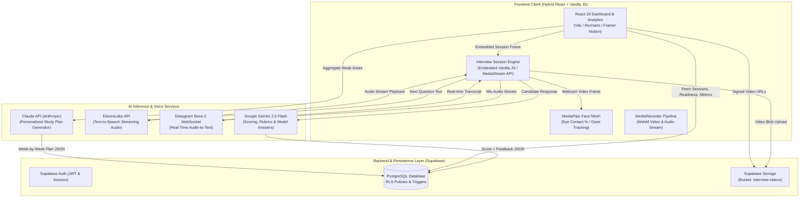
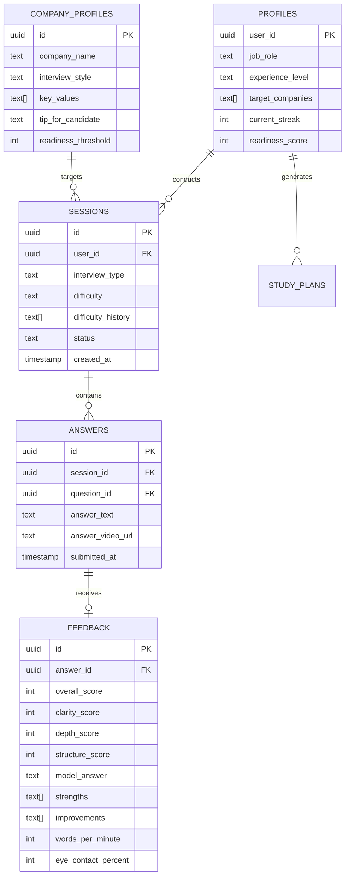

# Mock Interview Coach

Mock Interview Coach is a multimodal, real-time AI interview simulator and performance analytics platform. It pairs candidates face-to-face with an adaptive AI interviewer ("Alex"), scores responses across structured rubrics using **Google Gemini 2.5 Flash**, transcribes audio in real time via **Deepgram Nova-2**, synthesizes natural voice responses with **ElevenLabs**, tracks gaze and eye contact via **MediaPipe Face Mesh**, and generates tailored multi-week preparation schedules using **Claude 3.5**.

[](LICENSE)
[](https://nodejs.org)
[](https://react.dev)
[](https://vitejs.dev)
[](https://ai.google.dev)
[](https://supabase.com)

---

## Key Capabilities

- **Realistic Voice Interview Simulation**: Conducts voice-driven interviews with "Alex", featuring dynamic tone modulation, STAR-method probing, and natural turn-taking.
- **Rubric-Based AI Answer Evaluation**: Google Gemini 2.5 Flash evaluates answers on a 1–10 scale across Clarity, Depth, and Structure, outputting actionable strengths, improvement notes, and candidate model answers.
- **Real-Time WebSocket Speech-to-Text**: Low-latency spoken answer streaming through Deepgram's Nova-2 model with automatic client-side browser speech fallback.
- **Computer Vision Eye Tracking**: In-browser face landmark detection using MediaPipe Face Mesh computes real-time eye contact percentage and head stability during video recordings.
- **Adaptive Difficulty State Machine**: Automatically adjusts question difficulty (`easy` ↔ `medium` ↔ `hard`) based on the candidate's real-time answer score thresholds.
- **6-Signal Readiness Engine**: Calculates a comprehensive 0–100 Interview Readiness Score combining average scores, track coverage, trajectory trend, delivery metrics, consistency, and hard-difficulty performance.
- **Video Replay & Self-Audit**: Answers recorded via webcam are uploaded to Supabase Storage and rendered alongside synchronized coaching notes and difficulty timelines.
- **Target Company Culture Profiles**: Adapts interview style, evaluation lens, and behavioral expectations to profiles including Google, Amazon, Microsoft, Flipkart, and Startups.
- **Automated Study Plan Synthesis**: Claude analyzes historical weaknesses and cadence to generate personalized, multi-week study schedules with daily practice goals.

---

## Architecture Overview



---

## Core Engines & Technical Implementation

### 1. Per-Answer Evaluation Engine (Gemini 2.5 Flash)

Every submitted answer is evaluated by Google Gemini 2.5 Flash using structured output mode (`responseMimeType: 'application/json'`).

```
Candidate Answer + Question Context + Target Role
  │
  ▼
Gemini 2.5 Flash (temperature: 0.3, maxOutputTokens: 1024)
  │
  ▼
Strict JSON Schema Response:
  ├── overall_score (1 - 10)
  ├── clarity_score (1 - 10)
  ├── depth_score   (1 - 10)
  ├── structure_score (1 - 10)
  ├── strengths     (min 2 specific observations)
  ├── improvements  (min 3 actionable suggestions)
  └── model_answer  (ideal STAR-structure response)
```

**Resilience & Exponential Backoff:**  
Network requests to Gemini implement automatic retry with exponential backoff on HTTP `429` (Rate Limit) and `503` (Model Overloaded) errors, with in-flight retry feedback surfaced to the user.

---

### 2. Interview Readiness Algorithm (6 Weighted Signals)

The overall readiness index ($0 \text{ to } 100$) is computed in `src/lib/readinessService.js` across six normalized performance dimensions:

| Signal | Metric Description | Weight | Formula / Normalization |
| :--- | :--- | :---: | :--- |
| **Score Average** | Mean overall score of the last 10 completed sessions | **30%** | $\frac{\text{MeanScore}_{10}}{10} \times 100 \times 0.30$ |
| **Type Coverage** | Breadth across 4 core tracks (Behavioral, Technical, System Design, HR) | **20%** | $\frac{\text{UniqueTypesAttempted}}{4} \times 100 \times 0.20$ |
| **Score Trend** | Trajectory comparing last 3 sessions against preceding 3 sessions | **15%** | $\Delta > +0.5 \rightarrow 80\text{ pts}$<br>$\Delta < -0.5 \rightarrow 20\text{ pts}$<br>$\text{Flat} \rightarrow 50\text{ pts}$ |
| **Delivery Quality** | Composite score of cadence (WPM within 130–170 target) and eye contact % | **15%** | $\frac{\%_{\text{IdealPace}} + \text{EyeContact\%}}{2} \times 0.15$ |
| **Consistency** | Daily interview practice streak recorded in profile | **10%** | $\min(\text{Streak} \times 10, 100) \times 0.10$ |
| **Hard Difficulty** | Performance and frequency on hard-difficulty questions | **10%** | $\frac{\text{MeanScore}_{\text{Hard}}}{10} \times 100 \times 0.10$ |

---

### 3. Adaptive Difficulty State Machine

During the session, the AI adapts difficulty based on candidate performance without interrupting interview momentum:

```
                  ┌──────────────────────────────────────────────┐
                  ▼                                              │
          [ Current: EASY ] ──(Score ≥ 8)──▶ [ Current: MEDIUM ] │
                  ▲                                │       │     │
                  │              (Score ≤ 4)───────┘       │     │
                  │                                        │     │
                  │                         (Score ≥ 8)────┘     │
                  │                                │             │
                  │                                ▼             │
                  └─────────(Score ≤ 4)─────── [ Current: HARD ] ┘
```

- When `difficulty == 'hard'`, questions probe edge cases, architectural trade-offs, and failure recovery.
- When `difficulty == 'easy'`, questions focus on foundational principles and core concepts.

---

### 4. Computer Vision & Audio Delivery Pipeline

- **Eye Contact Tracking**: MediaPipe Face Mesh runs client-side at 30 FPS. Iris landmark coordinates are evaluated relative to camera bounding boxes to calculate the percentage of time gaze is maintained.
- **Pace Analysis**: Transcribed word timestamps are normalized into Words Per Minute (WPM). The ideal conversational delivery window is calibrated between **130 and 170 WPM**.
- **Filler Word Detection**: Transcripts are parsed for verbal crutches (`um`, `uh`, `like`, `you know`, `basically`, `actually`) and aggregated into delivery reports.

---

## Tech Stack

| Layer | Technologies |
| :--- | :--- |
| **Frontend Framework** | React 19, Vite 8, React Router v7 |
| **Styling & Animation** | Vanilla CSS Tokens, Framer Motion, Canvas Confetti |
| **Charts & Visualizations**| Recharts (Score Trend, Delivery Trend, Weak Areas, Skill Radar) · Chart.js |
| **Interview Engine** | Native HTML5 MediaDevices API, MediaRecorder, Canvas API, WebSockets |
| **Database & Auth** | Supabase (PostgreSQL, Row-Level Security, Storage Buckets, Triggers) |
| **AI & ML Models** | Google Gemini 2.5 Flash · Deepgram Nova-2 · ElevenLabs TTS · Anthropic Claude 3.5 · MediaPipe Face Mesh |

---

## Repository Structure

```
mock-interview-coach/
├── public/
│   ├── index-legacy.html        # Vanilla JS interview engine (Webcam, STT, TTS, FaceMesh)
│   └── index.html               # Main application template
├── src/
│   ├── components/
│   │   ├── AppLayout/           # Main application shell with navigation
│   │   ├── charts/              # Recharts components (Score, Delivery, Weak Area, Radar)
│   │   ├── ReadinessDial/       # Visual 0-100 gauge component
│   │   ├── StudyPlan/           # Multi-week roadmap view
│   │   └── StatStrip/           # Top-level performance KPI metrics
│   ├── context/
│   │   └── AuthContext.jsx      # Supabase authentication provider
│   ├── hooks/
│   │   ├── useDashboardData.js  # Aggregates scores, sessions, and streaks
│   │   ├── useHistoryData.js    # Session history with pagination and filters
│   │   └── useProgressData.js   # Analytics queries for trend charts
│   ├── lib/
│   │   ├── readinessService.js  # 6-signal readiness calculation logic
│   │   ├── studyPlanService.js  # Claude API client for study plan generation
│   │   └── supabase.js          # Supabase client initialization
│   ├── pages/
│   │   ├── DashboardPage.jsx    # Primary user hub & readiness overview
│   │   ├── HistoryPage.jsx      # Historical sessions and score logs
│   │   ├── OnboardingPage.jsx   # Role, experience level, and target companies setup
│   │   ├── ProgressPage.jsx     # Longitudinal trends, charts, and delivery telemetry
│   │   ├── ReplayPage.jsx       # Video replay player side-by-side with AI coaching notes
│   │   └── SessionPage.jsx      # Iframe wrapper for index-legacy.html with secure key injection
│   ├── styles/
│   │   └── tokens.css           # Global design tokens (colors, gradients, typography)
│   ├── App.jsx                  # Route definitions
│   └── main.jsx                 # React root entry point
├── supabase/
│   └── migrations/              # Database migrations and schema definitions
├── fix_rls.sql                  # Row-Level Security policies for sessions, feedback, and answers
├── query.sql                    # Initial seed data for company profiles and question banks
├── server.js                    # Local static development server fallback
├── package.json
└── vite.config.js
```

---

## Quickstart

### Prerequisites

- **Node.js**: `v20.0.0` or higher
- **npm**: `v10.0.0` or higher (Use `npm.cmd` on Windows PowerShell if execution policies apply)
- **Supabase Account**: A free Supabase project for database, auth, and video storage.

---

### 1. Clone & Install Dependencies

```bash
git clone https://github.com/navyaaa27/mock-interview-coach.git
cd mock-interview-coach
npm install
```

---

### 2. Configure Environment Variables

Create a `.env` file in the project root:

```env
# Supabase Configuration
VITE_SUPABASE_URL=https://your-project.supabase.co
VITE_SUPABASE_ANON_KEY=your-supabase-anon-key

# AI Model Keys
VITE_GEMINI_API_KEY=your_google_gemini_api_key
VITE_ELEVENLABS_API_KEY=your_elevenlabs_api_key
VITE_DEEPGRAM_API_KEY=your_deepgram_api_key
VITE_CLAUDE_API_KEY=your_anthropic_claude_api_key
```

| Key | Required For | Fallback Behavior if Missing |
| :--- | :--- | :--- |
| `VITE_SUPABASE_URL` | User auth, session storage, video replay | **Required** |
| `VITE_SUPABASE_ANON_KEY` | Public client database connection | **Required** |
| `VITE_GEMINI_API_KEY` | Real-time answer scoring & coaching feedback | Feedback generation disabled |
| `VITE_ELEVENLABS_API_KEY` | Realistic AI interviewer voice synthesis | Fallback to browser Web Speech TTS |
| `VITE_DEEPGRAM_API_KEY` | Real-time low-latency voice transcription | Fallback to browser SpeechRecognition |
| `VITE_CLAUDE_API_KEY` | Generating multi-week personalized study plans | Plan generation returns error prompt |

---

### 3. Database Initialization

Execute the SQL scripts in your Supabase SQL Editor in the following order:

1. **Schema & Seed Data**: Run [`query.sql`](query.sql) to initialize tables (`users`, `profiles`, `sessions`, `questions`, `answers`, `feedback`, `company_profiles`, `study_plans`) and seed standard question pools and company intel profiles.
2. **Security & RLS**: Run [`fix_rls.sql`](fix_rls.sql) to enforce Row-Level Security policies ensuring candidates only access their own sessions, recordings, and evaluations.
3. **Storage Bucket**: Create a public or signed bucket named `interview-videos` in the Supabase Storage console with upload permissions for authenticated users.

---

### 4. Run the Development Server

```bash
npm run dev
```

Open **[http://localhost:5173](http://localhost:5173)** in your browser.

- Sign up or log in to generate an active session.
- Select an interview track (Behavioral, Technical, System Design, or HR) on the Dashboard.
- Allow camera and microphone permissions when prompted to initiate the live interview with Alex.

---

## Database Schema Highlights



---

## Contributing

1. Fork the repository and create your feature branch: `git checkout -b feature/amazing-feature`
2. Commit your modifications with structured commit messages: `git commit -m 'feat: Add latency optimization for audio streaming'`
3. Verify local build and linting: `npm run build`
4. Push to your branch: `git push origin feature/amazing-feature`
5. Open a Pull Request.

---

## License

Distributed under the [MIT License](LICENSE).
